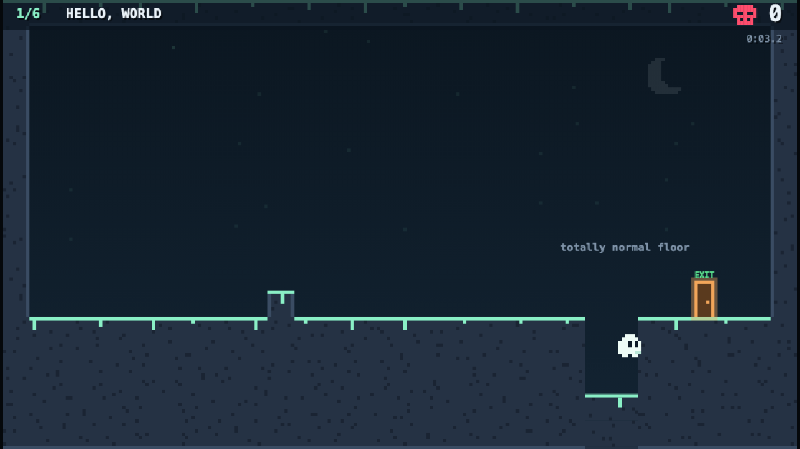
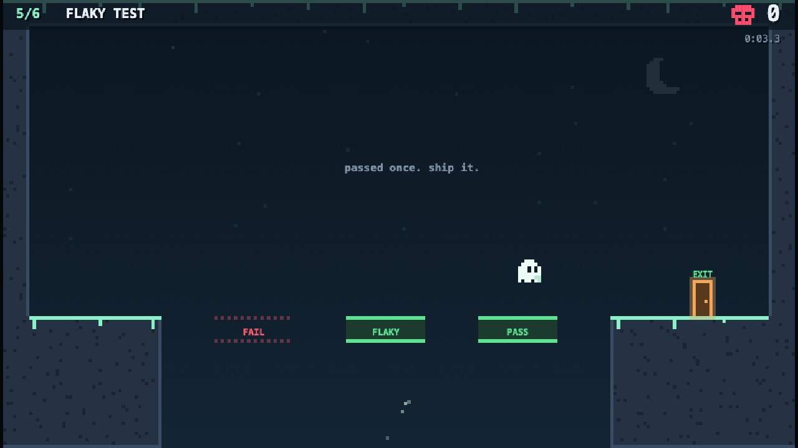
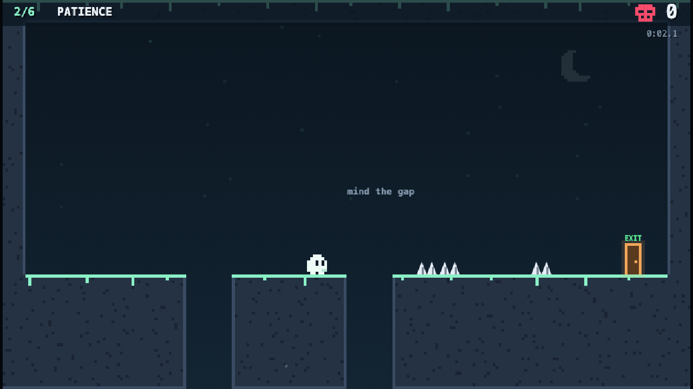
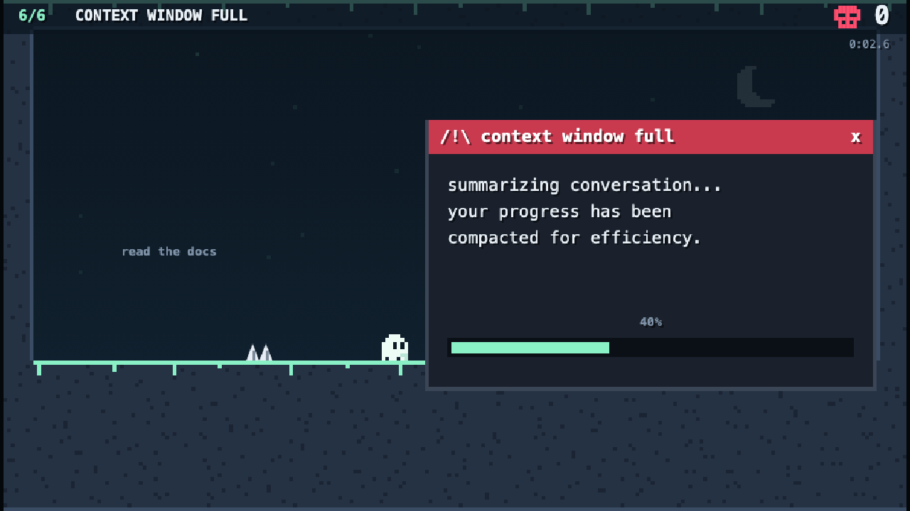

# Haunt Loop


**Play it in your browser:** https://evolutionaryarcade.com/g/haunt-loop

Guide Nullie, the ghost of a null pointer, through levels that look trivial and are absolutely not. Floors drop, spikes pop, the exit runs away, and the spec changes the moment you learn it.

A rage platformer about developer pain. Every death teaches you something. Mostly humility.

## Controls

| Action | Keyboard | Phone |
|---|---|---|
| Move | ← / → or A / D | on-screen ◀ ▶ pad (left side) |
| Jump (hold for higher) | Space, W or ↑ | JUMP (right side) |
| Restart level | R | R button |
| Pause | P or Esc | II button |
| Mute | M | arcade Mute button |

Phones play in landscape. Hold the phone upright and the game asks you to turn it sideways.

## Levels

| # | Name | The troll |
|---|---|---|
| 1 | Hello, World | The "totally normal floor" isn't. |
| 2 | Patience | Spikes pop up where you're about to land. Wait them out. |
| 3 | Exit Strategy | The exit runs away. Twice. |
| 4 | Spec Changed | A ceiling drops on you, and after your first death the whole level changes. |
| 5 | Flaky Test | Platforms blink PASS / FAIL on a schedule. Sprinting in fails. |
| 6 | Context Window Full | An error dialog hides the spikes, then a "context reset" sends you back to the start. |

Levels 7–12 are planned for v2: gravity flips, reversed controls, merge conflicts and a finale.

## Screenshots






## Run it locally

No build step and no dependencies. Serve the folder with any static server:

```bash
arcade dev                       # npm i -g evolutionary-arcade; serves with the arcade's CSP on :5173
python3 -m http.server 5173      # any static server also works
```

Then open http://localhost:5173/.

## Prove the levels can be beaten

The simulation is browser-free and deterministic. `tools/verify-levels.mjs` replays recorded inputs through the real game code. Every level must be cleared by its replay, and each "naive run" must get trolled, which proves the trap actually bites.

```bash
node tools/verify-levels.mjs            # all levels
node tools/verify-levels.mjs --trace 4  # step-by-step trace for one level
```

## How it's built

Vanilla ES modules and Canvas 2D. All art is drawn procedurally in chunky 4px pixels, and all sound is synthesized with Web Audio. Nothing loads from the network.

```
index.html          canvas host and mobile CSS
main.js             boot, game loop, state machine (title → play → pause / clear → finish)
src/config.js       every tuning constant: physics, timings, touch layout, colors
src/levels.js       the levels: 30×17 tile maps built with a tiny builder, plus their traps
src/traps.js        trap types: drop, pop, flee, crush, flaky, dialog, teleport
src/sim.js          one attempt at a level: map, traps, player, hazards (browser-free)
src/physics.js      movement with coyote time, jump buffer, variable jump, AABB collision
src/render.js       Nullie, tiles, spikes, door, particles
src/ui.js           HUD, menus, dialogs, taunt bubbles, title scene
src/input.js        keyboard → actions
src/touch.js        on-screen multi-touch controls in the side gutters
src/audio.js        synthesized sound effects, arcade mute support
src/save.js         local progress (prefixed, versioned localStorage)
src/taunts.js       what Nullie says when you die
tools/              level verifier and recorded replays
media/              thumbnail and screenshots
```

### Adding a level

1. Add an entry to `LEVELS` in `src/levels.js`. Build the map with `build()` and use lowercase letters for trap tile groups.
2. Attach traps from `src/traps.js`. Every trap supports `zone`, `delay`, `minDeaths` and `maxDeaths`.
3. Record a solution in `tools/replays.mjs`, plus a `naive(...)` run that should die. Then run `node tools/verify-levels.mjs`.

## License

MIT. See [LICENSE](LICENSE).
